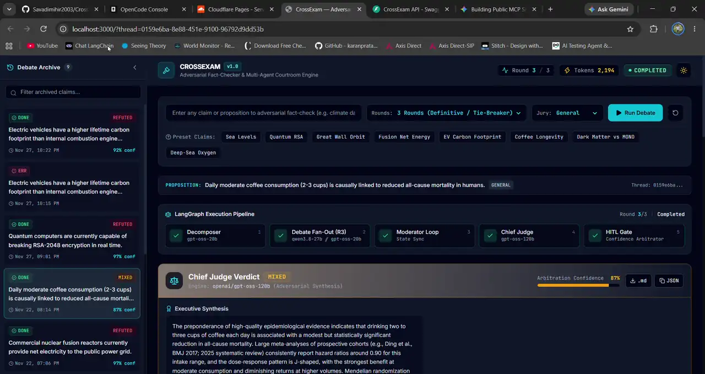

# CrossExam: Adversarial Fact-Checker & Multi-Agent Debate Engine

[](https://www.python.org/)
[](https://fastapi.tiangolo.com/)
[](https://langchain-ai.github.io/langgraph/)
[](https://react.dev/)
[](https://www.typescriptlang.org/)
[](https://tailwindcss.com/)

> **A production-grade, adversarial multi-agent courtroom fact-checking engine built with FastAPI, LangGraph, SQLite, React 18, and Tailwind CSS.**

---

## 🎬 Live Demo Walkthrough



> 📺 **[Download Full 1080p HD Walkthrough (`assets/crossexam-demo.mp4`)](assets/crossexam-demo.mp4)** — End-to-end demonstration of multi-round adversarial debate, live DuckDuckGo grounding, Chief Judge verdict synthesis, and Light/Dark War-Room UI.

---

## 📖 Table of Contents

- [Executive Overview](#-executive-overview)
- [Why Adversarial Fact-Checking?](#-why-adversarial-fact-checking)
- [System Architecture](#-system-architecture)
- [Multi-Model Groq Free-Tier Routing](#-multi-model-groq-free-tier-routing)
- [Core Engineering Highlights](#-core-engineering-highlights)
- [Repository Structure](#-repository-structure)
- [Quickstart Guide](#-quickstart-guide)
  - [Two Ways to Use CrossExam](#two-ways-to-use-crossexam)
  - [Prerequisites](#prerequisites)
  - [Backend Setup](#1-backend-setup)
  - [Frontend Setup](#2-frontend-setup)
- [Bring Your Own API Key (BYOAK)](#-bring-your-own-api-key-byoak)
- [API Reference](#-api-reference)
- [Verification & Automated Test Suite](#-verification--automated-test-suite)
- [Frontend War-Room Architecture](#-frontend-war-room-architecture)
- [License](#-license)

---

## 🏛️ Executive Overview

Standard LLM fact-checkers suffer from single-model confirmation bias, sycophancy, and hallucinated consensus: when prompted with a premise, they frequently hallucinate supporting arguments while overlooking contradictory evidence.

**CrossExam** treats truth-seeking as an adversarial legal proceeding. Rather than relying on a solitary model's judgment, CrossExam:

1. **Decomposes** complex user claims into testable, atomic sub-claims.
2. **Fans out concurrently** using LangGraph's `Send()` API to an affirmative **Proponent** and a red-team **Skeptic** agent.
3. **Retrieves live web ground-truth** via DuckDuckGo search, distilled into clean, non-HTML citation snippets.
4. **Conducts multi-round debates** through a synchronized **Moderator** node using sliding-window context to stay strictly within token budgets.
5. **Issues a structured verdict** via a high-reasoning **Chief Judge** auditing each sub-claim and source URL.
6. **Engages Human-in-the-Loop (HITL)** whenever verdict confidence falls below 75%, allowing human arbiters to provide disambiguating context and trigger re-scoring.

---

## ⚖️ Why Adversarial Fact-Checking?

```
Traditional LLM Verification:
  [Claim] ───> [Single LLM] ───> [Hallucinated / Sycophantic Consensus]

CrossExam Adversarial Courtroom:
                   ┌──> [Proponent (Qwen-27B)] ──> [Live Web Evidence] ──┐
  [Claim] ──> [Decomposer]                                               ├──> [Chief Judge (120B)] ──> [Verdict]
                   └──> [Skeptic (GPT-OSS-20B)] ──> [Live Web Evidence] ─┘
```

- **Confirmation Bias Mitigation:** Two specialized models argue opposite sides under explicit evidentiary burdens.
- **Sliding-Window Efficiency:** In multi-round debates, agents only see atomic sub-claims and their opponent's previous round rebuttal—not raw search dumps—staying well within the 8K TPM rate limit.
- **Audited Citations:** Claims must cite live retrieved URLs; unverified assertions are penalized during Chief Judge arbitration.

---

## 🏛️ System Architecture

The core graph is orchestrated via **LangGraph** (`StateGraph`) with persistent SQLite state checkpoints:

```text
                                  ┌────────────────────────┐
                                  │   User Claim Input     │
                                  └───────────┬────────────┘
                                              │
                                              ▼
                                  ┌────────────────────────┐
                                  │   Guard Node (Fast)    │
                                  │  llama-prompt-guard    ├──────────────┐ (Injection Flagged)
                                  └───────────┬────────────┘              │
                                              │ (Clean Claim)             │
                                              ▼                           │
                                  ┌────────────────────────┐              │
                                  │    Decomposer Node     │              │
                                  │     gpt-oss-20b        │              │
                                  └───────────┬────────────┘              │
                                              │                           │
                      ┌───────────────────────┴───────────────────────┐   │
                      │ Parallel Send() Fan-Out                       │   │
                      ▼                                               ▼   │
         ┌────────────────────────┐                      ┌────────────────────────┐
         │ Proponent Node (8K TPM)│                      │  Skeptic Node (8K TPM) │
         │      qwen3.8-27b       │                      │      gpt-oss-20b       │
         │ DuckDuckGo Search (#3) │                      │ DuckDuckGo Search (#3) │
         │   SUPPORT Argument     │                      │   REFUTE Argument      │
         └────────────┬───────────┘                      └────────────┬───────────┘
                      │                                               │
                      └───────────────────────┬───────────────────────┘
                                              ▼
                                  ┌────────────────────────┐
                                  │     Moderator Node     │  (Round < Max: loop)
                                  │  Sync Barrier & Router ├───────────┐
                                  └───────────┬────────────┘           │
                                              │ (Round >= Max)         │
                                              ▼                        │
                                  ┌────────────────────────┐           │
                                  │    Chief Judge Node    │           │
                                  │     gpt-oss-120b       │           │
                                  │ VerdictSchema & Audit  │           │
                                  └───────────┬────────────┘           │
                                              │                        │
                                              ▼                        │
                                  ┌────────────────────────┐           │
                       ┌──────────┤   HITL Gate Node       │           │
                       │          │  interrupt() if < 0.75 │           │
                       │          └───────────┬────────────┘           │
       Command(resume) │                      │ (Confidence >= 0.75)   │
       Re-Score        ▼                      ▼                        ▼
          ┌─────────────────────┐    ┌───────────────────────────────────┐
          │ Chief Judge Rescore │    │        Persist Node (End)         │
          └──────────┬──────────┘    │ writes to debates.db (SQLite)     │
                     │               └───────────────────────────────────┘
                     └────────────────────────┬────────────────────────┘
```

---

## 🚀 Multi-Model Groq Free-Tier Routing

Groq's Free Plan enforces an **8,000 Tokens Per Minute (TPM)** bucket limit _per model ID_. If parallel branches (`Send()`) share a single model identifier, concurrent fan-out risks immediate `429 RateLimitError` exceptions.

CrossExam solves this by routing separate courtroom responsibilities to isolated models across distinct token buckets:

| Role             | Model Identifier                      | Free Tier Limits | Engineering Responsibility                                       |
| :--------------- | :------------------------------------ | :--------------- | :--------------------------------------------------------------- |
| **Prompt Guard** | `meta-llama/llama-prompt-guard-2-22m` | 30 RPM / 15K TPM | Early-rejection filter for prompt-injections & jailbreak attacks |
| **Decomposer**   | `openai/gpt-oss-20b`                  | 30 RPM / 8K TPM  | Decomposes claim into 2–3 atomic, testable sub-claims            |
| **Proponent**    | `qwen/qwen3.8-27b`                    | 30 RPM / 8K TPM  | Live search & ~180-word affirmative evidence argument            |
| **Skeptic**      | `openai/gpt-oss-20b`                  | 30 RPM / 8K TPM  | Live search & ~180-word adversarial counter-argument             |
| **Chief Judge**  | `openai/gpt-oss-120b`                 | 30 RPM / 8K TPM  | High-reasoning synthesis, confidence scoring & citation audit    |

All Groq invocations are wrapped with **`tenacity` exponential backoff retries** handling HTTP 429 and connection jitter gracefully.

---

## 💡 Core Engineering Highlights

### 1. Dual-Database SQLite Architecture (WAL-Enabled)

- **`checkpoints.db` (`AsyncSqliteSaver`):** LangGraph's native thread-scoped checkpointer. Tracks execution checkpoints per `thread_id`, enabling zero-loss `interrupt()` and seamless graph resumption via `Command(resume=...)`.
- **`debates.db` (Async SQLite Repository):** WAL-enabled relational table storing debate history (`thread_id`, `claim`, `status`, `max_rounds`, `mode`, `verdict`, `confidence`, `total_tokens`, `report_json`, `created_at`). Persists both completed and paused HITL states across restarts.

### 2. Domain Jury Modes & Live URL Verification

- **4 Specialized Jury Modes:** `general`, `scientific` (PubMed/arXiv/peer-reviewed bias), `financial` (SEC/earnings/macro data), and `security` (CVEs/NVD/OWASP) tailor both web search queries and Chief Judge evaluation criteria.
- **Live HTTP Reachability Audit:** Before the Judge scores `citation_audit`, `verifier.py` concurrently checks cited URLs over HTTP (`HEAD`/`GET`) to flag `LIVE` (`200`) vs `UNREACHABLE` (`404`/dead) sources.

### 3. Context Isolation & Real Token Telemetry

- Round 1 provides each debater only with the atomic sub-claims and dynamically generated queries.
- Round 2+ passes a **sliding window**: debaters receive _only_ the opponent's previous argument and sub-claims—eliminating recursive token bloat and staying under Groq's 8K TPM threshold.
- Structured outputs capture real Groq `token_usage` metadata and automatically fall back to `json_mode` if tool-call validation fails.

### 4. Defensive Web Search & Text Sanitization

- `ddgs` DuckDuckGo search wrapped with strict timeouts, empty-query fallbacks, and connection error guards.
- Two-pass sanitization: unescapes HTML entities (`&lt;b&gt;`), strips raw tags (`<[^>]+>`), unescapes again, and truncates snippets to ~120 words to avoid context contamination.

### 5. Real-Time Server-Sent Events (SSE) Engine

- The backend emits structured, typed SSE events throughout graph execution:
  - `node_start` / `guard_alert`: Real-time pipeline status & prompt-guard alerts.
  - `tool_call`: Live DuckDuckGo queries and retrieved source pills.
  - `argument`: Streaming debater text, citations, evidence metadata, and live token updates.
  - `interrupt`: Signals UI that human intervention is required (`confidence < 0.75`).
  - `final_verdict`: Complete `VerdictSchema` JSON payload with audited citations.

---

## 🛠️ Repository Structure

```text
CrossExam/
├── backend/
│   ├── app/
│   │   ├── api/
│   │   │   ├── __init__.py
│   │   │   └── routes.py         # REST + SSE endpoints + /api/config + /api/validate-key (BYOAK)
│   │   ├── db/
│   │   │   ├── __init__.py
│   │   │   └── sqlite.py         # Async WAL SQLite CRUD, auto-migrations & session_id column
│   │   ├── graph/
│   │   │   ├── __init__.py
│   │   │   ├── nodes.py          # Guard, Decomposer, Proponent, Skeptic, Moderator, Judge, HITL
│   │   │   │                     #   + ContextVar API key/models/temperature isolation (BYOAK)
│   │   │   ├── state.py          # DebateState TypedDict & Pydantic output schemas
│   │   │   └── workflow.py       # StateGraph builder + AsyncSqliteSaver
│   │   ├── tools/
│   │   │   ├── __init__.py
│   │   │   ├── search.py         # Defensive DuckDuckGo search & entity cleaner
│   │   │   └── verifier.py       # Async HTTP URL reachability verifier
│   │   ├── cli.py                # Terminal runner (python -m app.cli)
│   │   ├── mcp_server.py         # Zero-dependency stdio MCP server
│   │   ├── config.py             # Pydantic BaseSettings + resolve_api_key() + get_model_presets()
│   │   └── main.py               # FastAPI lifespan, CORS, & route mounting
│   ├── tests/
│   │   ├── __init__.py
│   │   ├── conftest.py           # Autouse live-API guard
│   │   ├── test_sqlite.py        # SQLite WAL CRUD & Jury Mode tests
│   │   ├── test_tools.py         # DuckDuckGo & HTTP URL verifier tests
│   │   ├── test_nodes.py         # Guard, Decomposer, Send(), Moderator & fallback tests
│   │   ├── test_workflow_e2e.py  # 1-3 round E2E graph & HITL interrupt/resume tests
│   │   ├── test_api_and_mcp.py   # FastAPI REST/SSE & MCP server dispatch tests
│   │   └── test_byoak.py         # NEW: 8 BYOAK privacy, ContextVar reset & session-ID tests
│   ├── .env.example              # Template for environment configuration
│   ├── pytest.ini                # Pytest configuration with asyncio support
│   └── requirements.txt          # Pinned backend dependencies
├── frontend/
│   ├── src/
│   │   ├── components/
│   │   │   ├── CourtroomSplit.tsx    # Proponent vs. Skeptic streaming debate cards
│   │   │   ├── ExecutionGraph.tsx    # 5-stage live status pipeline bar
│   │   │   ├── HistorySidebar.tsx    # Saved & paused debates archive drawer
│   │   │   ├── JudgeVerdictCard.tsx  # Verdict, export (.md/JSON) & HITL intervention
│   │   │   ├── SettingsPanel.tsx     # NEW: collapsible BYOAK API key, model tier & key-test UI
│   │   │   └── SseInspector.tsx      # Live SSE event telemetry & state viewer
│   │   ├── hooks/
│   │   │   ├── useDebateStream.ts    # SSE event management, BYOAK headers, sessionStorage hook
│   │   │   └── useTheme.ts           # Dual-mode Light & Dark theme hook
│   │   ├── types/
│   │   │   └── debate.ts             # Strict TypeScript types + ModelPreset, ApiSettings, ServerConfig
│   │   ├── App.tsx                   # Dual-mode War-Room dashboard + temperature slider
│   │   └── index.css                 # Semantic Light/Dark CSS tokens & Tailwind CSS
│   ├── package.json
│   ├── tailwind.config.js
│   └── vite.config.ts
└── README.md
```

---

## ⚡ Quickstart Guide

### Two Ways to Use CrossExam

CrossExam supports **two usage modes** that work simultaneously on the same running server:

| Mode | Who it's for | Where the key lives | Server config needed? |
|------|-------------|--------------------|-----------------------|
| **Server Mode** | Self-hosters, local dev, internal teams | `backend/.env` — set once, shared by all UI sessions on that server | ✅ Set `GROQ_API_KEY` in `.env` |
| **BYOAK Mode** | Public demos, visitors, external testers | Pasted into the UI Settings Panel — lives in browser `sessionStorage`, cleared when the tab closes, **never stored server-side** | ❌ Leave `GROQ_API_KEY` empty |

Both modes are active at the same time:
- If `.env` has a valid `GROQ_API_KEY`, the server uses it by default for all requests.
- If a visitor pastes their own key in the **Settings Panel**, their key takes **precedence for that session only** via a task-local `ContextVar` — the server key is ignored for that request.
- If neither is present, the stream immediately emits an `error` SSE event with a human-readable message.

---

### Prerequisites

- **Python 3.11+**
- **Node.js 18+ & npm**
- **Groq API Key** — _optional for BYOAK mode_; get one free at [console.groq.com](https://console.groq.com/)

---

### 1. Backend Setup

```bash
cd backend

# 1. Create and activate virtual environment
python -m venv .venv

# On Linux/macOS:
source .venv/bin/activate
# On Windows PowerShell:
.venv\Scripts\Activate.ps1

# 2. Install dependencies
pip install -r requirements.txt

# 3. Configure environment variables
cp .env.example .env

# Edit .env and insert your Groq API key (required for Server Mode):
# GROQ_API_KEY=gsk_your_actual_key_here
#
# Running in BYOAK mode only? Leave GROQ_API_KEY empty — users paste
# their own key into the UI Settings Panel instead. The server starts fine.
```

**Launch Backend Server:**

```bash
uvicorn app.main:app --host 127.0.0.1 --port 8000 --reload
```

Interactive OpenAPI Swagger docs will be live at `http://127.0.0.1:8000/docs`.

---

### 2. Frontend Setup

In a separate terminal:

```bash
cd frontend

# 1. Install dependencies
npm install

# 2. Start Vite development server
npm run dev
```

Open `http://localhost:3000` (or `http://localhost:5173`) in your browser to enter the **War-Room**.

---

## 📡 API Reference

| Method | Endpoint                             | Description                                                                                                                               |
| :----- | :----------------------------------- | :---------------------------------------------------------------------------------------------------------------------------------------- |
| `GET`  | `/api/config`                        | Returns `{ server_key_configured: bool, default_models: {...}, model_presets: {...} }`. Used by UI to decide whether to show BYOAK panel. |
| `POST` | `/api/validate-key`                  | Accepts `{ api_key: str }`. Pings Groq with 1 token to validate without storing the key. Returns `{ valid: bool, error?: str }`.         |
| `POST` | `/api/debates`                       | Accepts `{ "claim": str, "max_rounds": int, "mode": str }` + optional `X-Session-ID` header. Returns `{ "thread_id": str }`.            |
| `GET`  | `/api/debates`                       | Fetches recent debate records for history sidebar. Accepts `X-Session-ID` to filter by session (legacy NULL rows always included).        |
| `GET`  | `/api/debates/{thread_id}`           | Retrieves a complete persisted debate record by ID.                                                                                       |
| `GET`  | `/api/debates/{thread_id}/stream`    | SSE endpoint streaming real-time events (`node_start`, `tool_call`, `argument`, `round_complete`, `interrupt`, `final_verdict`, `error`). BYOAK headers: `X-API-Key`, `X-Model-Preset`, `X-Models`, `X-Temperature`, `X-Session-ID`. |
| `POST` | `/api/debates/{thread_id}/intervene` | Resumes a paused debate with `{ "human_context": str }` via `Command(resume=...)` and streams re-scoring. Accepts same BYOAK headers.    |
| `GET`  | `/health`                            | Service health status and configured model IDs.                                                                                           |

---

## 🧪 Verification & Automated Test Suite

CrossExam includes a modular, feature-wise automated test suite (`backend/tests/`) that mocks all LLM, search, and HTTP calls so zero live API calls are made.

Run all tests or individual feature files from `backend/`:

```bash
cd backend
# Run all feature suites together:
.venv\Scripts\pytest tests/ -v

# Or run an individual feature suite:
.venv\Scripts\pytest tests/test_nodes.py -v
.venv\Scripts\pytest tests/test_workflow_e2e.py -v
```

### 29 Test Cases Passed:

1. `test_sqlite_persistence`: Async SQLite CRUD, thread isolation, and `max_rounds` persistence.
2. `test_search_clean_text`: HTML entity unescaping (`&lt;b&gt;`) and raw tag removal.
3. `test_search_empty_query`: Defensive handling of empty search inputs.
4. `test_search_mocked`: Mocked DuckDuckGo snippet extraction.
5. `test_guard_node_pass`: Clean claim traversal through the prompt guard.
6. `test_guard_node_injection_rejection`: Prompt injection detection and routing directly to `persist_node`.
7. `test_decomposer_node`: Structured claim decomposition into atomic sub-claims.
8. `test_fan_out_to_debaters`: LangGraph `Send()` parallel dispatch to Proponent and Skeptic.
9. `test_proponent_and_skeptic_nodes`: Debater argument synthesis and citation anchoring.
10. `test_moderator_loop_routing`: Conditional edge looping and max rounds sync barrier.
11. `test_hitl_interrupt_and_command_resume`: `interrupt()` pause on low confidence and `Command(resume=...)` re-scoring.
12. `test_fastapi_endpoints_and_jury_mode`: Health, debate creation with Jury Mode, list, and single-item retrieval endpoints.
13. `test_missing_groq_api_key_fails_gracefully`: Graceful degradation and descriptive error responses.
14. `test_full_debate_graph_rounds_execution` (3 cases: 1, 2, and 3 rounds): Complete end-to-end graph cycles including odd tie-breaker.
15. `test_full_debate_graph_prompt_injection_halts_early`: Zero-token expenditure on injection attempts.
16. `test_stream_missing_key_emits_error_and_persists`: Missing API key emits SSE `error` and persists `status="error"`.
17. `test_url_reachability_verifier`: Live HTTP reachability check (`verified_live` vs `unreachable` vs `unverified`).
18. `test_structured_tool_use_failed_falls_back_to_json_mode`: Automatic `json_mode` retry on Groq `400 tool_use_failed`.
19. `test_mcp_server_dispatch`: Zero-dependency MCP stdio JSON-RPC `initialize`, `tools/list`, and `tools/call`.
20. `test_byoak` (8 tests in `tests/test_byoak.py`): Server-mode backward compatibility, BYOAK key override, model presets/custom slots, `/api/config`, `/api/validate-key`, `X-Session-ID` history isolation, proof that API keys never leak into SQLite, SSE events, or lingering `ContextVar` state, and guarded temperature clamping per node role.

---

## 🔑 Bring Your Own API Key (BYOAK)

> **Privacy guarantee:** Your API key is **never written to `debates.db`, `checkpoints.db`, any log file, or any SSE event payload**. It lives only in your browser's `sessionStorage` (tab-scoped, cleared on close) and in a Python task-local `ContextVar` in RAM for the duration of a single stream — no cross-request leakage is possible even if the `finally` block were somehow missed, because `ContextVar` has `default=None`.

### How to use BYOAK (step-by-step)

1. **Start the server without a `.env` key** (or leave `GROQ_API_KEY` empty in `.env`).
2. **Open the UI** at `http://localhost:3000` — the **Settings Panel** will auto-expand because no server key is configured.
3. **Paste your Groq API key** (`gsk_...`) into the masked input field.
4. **Click "Test Key"** — CrossExam calls `POST /api/validate-key` which performs a 1-token ping to Groq and returns `{ valid: true }`. Nothing is stored server-side.
5. **Choose a Model Tier** (or leave on the default):

| Tier | Decomposer | Proponent | Skeptic | Judge |
|------|-----------|-----------|---------|-------|
| **Balanced** _(default)_ | `openai/gpt-oss-20b` | `qwen/qwen3.8-27b` | `openai/gpt-oss-20b` | `openai/gpt-oss-120b` |
| **Fast** | `openai/gpt-oss-20b` | `openai/gpt-oss-20b` | `openai/gpt-oss-20b` | `openai/gpt-oss-20b` |
| **Smart** | `openai/gpt-oss-20b` | `openai/gpt-oss-120b` | `openai/gpt-oss-120b` | `openai/gpt-oss-120b` |
| **Custom** | _(you pick each slot)_ | _(you pick each slot)_ | _(you pick each slot)_ | _(you pick each slot)_ |

6. **Adjust the Temperature slider** (optional) next to the Jury Mode selector in the claim bar:
   - `0.0` → fully deterministic (best for reproducibility and citation-heavy claims)
   - `0.7` → exploratory (more creative arguments, broader search angle)
   - The backend **hard-clamps** per role regardless of what you send:
     - **Guard:** always `0.0` (security — never randomized)
     - **Decomposer & Judge:** max `0.3` (structured output grounding)
     - **Proponent & Skeptic:** max `0.7` (your slider value is respected up to this cap)

7. **Run a debate** — your key is forwarded via `X-API-Key` HTTP header on each SSE stream request. Session history is isolated per browser tab via `X-Session-ID` (a UUID stored in `sessionStorage`).

### What CrossExam never does with your key

| ❌ Never | ✅ What actually happens |
|----------|------------------------|
| Write key to `debates.db` | Key resolved from `ContextVar` per-request |
| Write key to `checkpoints.db` | LangGraph checkpoints store only graph state |
| Emit key in any SSE event | SSE payloads contain only debate content |
| Log key to stdout/stderr | Only sanitized error types are logged |
| Store key in `localStorage` | Stored in `sessionStorage` only (tab-lifetime) |
| Share key across browser tabs | Each tab gets its own UUID session |

---

## 💻 CLI & MCP Integration

Run CrossExam directly from your terminal:

```bash
cd backend
.venv\Scripts\python -m app.cli "Commercial nuclear fusion provides net grid electricity." --rounds 3 --mode scientific
```

Or mount `backend/app/mcp_server.py` as a stdio **MCP Server** in Cursor, Claude Code, or Antigravity to expose `verify_claim` and `list_recent_debates` directly to your coding agent.

---

## 🖥️ Frontend War-Room Architecture (Light & Dark Mode)

The user interface ships with dual-mode Light & Dark parity while preserving the intelligence war-room aesthetic:

- **Telemetry Header:** Real-time round tracking, cumulative token usage meter, status badge, and Sun/Moon theme toggle.
- **Settings Panel (`SettingsPanel.tsx`):** Collapsible BYOAK panel (auto-expands when no server key is set). Paste and test your Groq API key, pick a Model Tier (Balanced/Fast/Smart/Custom), or configure individual per-node model slots. Privacy footer confirms keys are never stored server-side.
- **Claim Bar, Jury Selector & Temperature Slider:** 8 one-click preset claims, `1 / 2 / 3` round selector, `General / Scientific / Financial / Security` Jury Mode selector, and a **Temperature slider** (`0.0–0.7`) to tune Debater creativity (Guard, Decomposer, and Judge are always server-clamped regardless of this value).
- **5-Node Execution Graph (`ExecutionGraph.tsx`):** Visualizes live progress across `Decomposer` → `Debaters (Parallel)` → `Moderator` → `Chief Judge` → `HITL Gate`.
- **Courtroom Split (`CourtroomSplit.tsx`):** Side-by-side blue (Proponent) and red (Skeptic) columns displaying round badges, search query pills, and live citation verification indicators.
- **Chief Judge Verdict Card (`JudgeVerdictCard.tsx`):** Renders verdicts, confidence meters, sub-claim breakdowns, HTTP-verified citation audits, `.md` / `JSON` dossier export, and an inline amber HITL intervention form when paused.
- **Backend Inspector (`SseInspector.tsx`):** Inspect raw SSE event stream messages and examine the live LangGraph state tree in real time.
- **History Sidebar (`HistorySidebar.tsx`):** Search, browse, and re-hydrate past and paused debates (synced with `?thread=<id>` permalinks); filters by session ID in BYOAK mode.

---

## 🌐 Free Public Deployment ($0, No Credit Card)

CrossExam is deploy-ready for a **$0 public BYOAK demo** using **Cloudflare Pages** (Frontend) + **Render Free** (Backend) + a **Cloudflare Worker Cron** keep-alive ping:

1. **Backend on Render (`render.yaml`):**
   - Go to [dashboard.render.com](https://dashboard.render.com/) → **New +** → **Blueprint** → connect this repo.
   - `render.yaml` configures the Python 3.12 FastAPI service on the `free` plan with `GROQ_API_KEY=""` (BYOAK mode active out of the box).
   - Copy your Render URL (e.g., `https://crossexam-api.onrender.com`).

2. **Frontend on Cloudflare Pages:**
   - Go to [dash.cloudflare.com](https://dash.cloudflare.com/) → **Workers & Pages** → **Create** → **Pages** → **Connect to Git**.
   - Root directory: `frontend` | Build command: `npm run build` | Output directory: `dist`.
   - Set environment variable `VITE_API_BASE_URL` = `https://crossexam-api.onrender.com` (no trailing slash).

3. **Keep-Alive Cron Worker (`keepalive-worker/`):**
   - Deploy `keepalive-worker/src/index.js` (`npx wrangler deploy` or via Cloudflare Dashboard) and set `RENDER_HEALTH_URL` = `https://crossexam-api.onrender.com/health`.
   - Pings `/health` every 10 minutes (`*/10 * * * *`) so Render stays warm without hitting its 15-minute sleep timer.

---

## ⚖️ License

Distributed under the **MIT License**. See [LICENSE](LICENSE) for details. Built for high-assurance, defensible truth verification.
