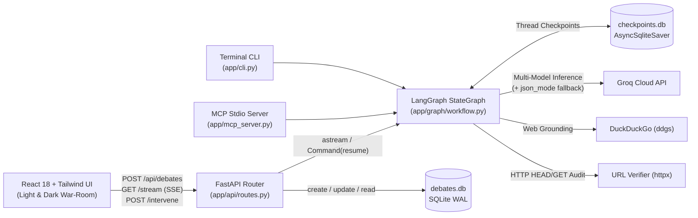
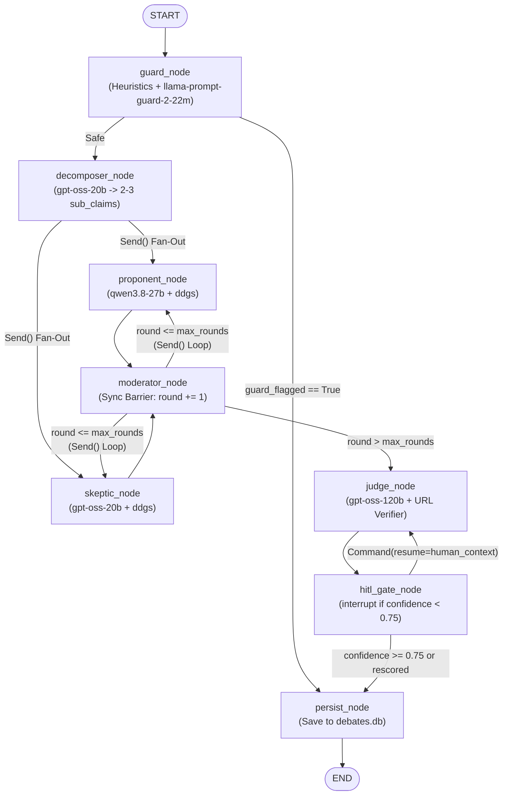

# CrossExam — Technical Architecture & Engineering Specification

> **Document Scope:** Complete architectural, operational, and testing reference for **CrossExam**, an adversarial multi-agent fact-checking and debate engine built with FastAPI, LangGraph, SQLite (WAL), Groq Cloud, and React 18 + TypeScript + Tailwind CSS.

---

## 1. Why CrossExam Was Built

Standard single-LLM fact-checkers suffer from three well-documented failure modes:

1. **Confirmation Bias & Sycophancy:** When a single model is asked to evaluate a controversial or nuanced claim, it tends to agree with the framing of the prompt rather than actively seeking falsifying counter-evidence.
2. **Hallucinated Citations:** Models frequently invent plausible-looking URLs or cite stale sources without verifying whether the endpoint actually resolves.
3. **Context Bloat & Free-Tier Rate-Limit Collisions:** Dumping raw HTML or full multi-round transcripts into a single model quickly breaches Groq's **8,000 Tokens Per Minute (TPM)** per-model free-tier cap.

**CrossExam** solves these by structuring fact-checking as an **adversarial courtroom proceeding** backed by:

- **Role-isolated multi-model routing** across separate Groq TPM buckets (`qwen/qwen3.8-27b`, `openai/gpt-oss-20b`, `openai/gpt-oss-120b`, `meta-llama/llama-prompt-guard-2-22m`).
- **Concurrent `Send()` fan-out** to a Proponent (SUPPORT) and Red-Team Skeptic (REFUTE), each grounded in live DuckDuckGo (`ddgs`) web search.
- **Sliding-window context isolation** in Round 2+, where debaters see only `sub_claims` and the opponent's _previous round_ argument.
- **Live HTTP URL reachability verification** (`verifier.py`) before the Chief Judge issues a `VerdictSchema`.
- **LangGraph `interrupt()` + `Command(resume=...)` Human-in-the-Loop (HITL)** pausing whenever Judge confidence falls below `0.75`.

---

## 2. Project Scope

### In Scope

- **Adversarial LangGraph Pipeline:** Guard → Decomposer → Parallel Proponent/Skeptic (`1–3` configurable rounds, default `3` odd tie-breaker) → Moderator Sync Barrier → Chief Judge → HITL Gate → SQLite Persistence.
- **Domain Jury Modes:** `general`, `scientific`, `financial`, and `security` modes tailoring search query bias and Judge evaluation criteria.
- **Dual SQLite Persistence (WAL-enabled):**
  - `checkpoints.db` (`AsyncSqliteSaver`) for thread-scoped LangGraph pause/resume state.
  - `debates.db` (`aiosqlite`) for debate metadata, history sidebar hydration, paused-state snapshots, and final reports.
- **Real-Time SSE Streaming:** Typed Server-Sent Events (`node_start`, `guard_alert`, `sub_claims`, `tool_call`, `argument`, `round_complete`, `interrupt`, `verdict_preview`, `final_verdict`, `error`).
- **Dual-Mode War-Room UI:** React 18 + Tailwind CSS with Light & Dark mode parity, live 5-node pipeline graph, split-screen courtroom, `.md`/`JSON` dossier export, `?thread=<id>` permalinks, and SSE/State inspector.
- **Developer Ecosystem Interfaces:** Standalone CLI (`python -m app.cli`) and zero-dependency stdio MCP Server (`backend/app/mcp_server.py`).

### Out of Scope (Intentional MVP Boundaries)

- Multi-tenant authentication / user accounts (local-first single-workspace design).
- Distributed message queues (Redis/Celery)—handled cleanly in-process via FastAPI `StreamingResponse` + `asyncio`.
- Full-page JavaScript browser scraping (uses distilled `ddgs` snippets + `httpx` HTTP status verification to stay fast and token-lean).

---

## 3. System Architecture Diagrams

### 3.1 High-Level Component Architecture



### 3.2 LangGraph Cyclic Orchestration & HITL Flow



---

## 4. End-to-End Execution Flow

1. **Session Creation (`POST /api/debates`)**:
   - The frontend submits `{ claim, max_rounds, mode }`.
   - `routes.py` generates a `thread_id` (UUID), inserts a `"running"` row into `debates.db`, and returns `{ thread_id }`.
2. **Stream Initialization (`GET /api/debates/{thread_id}/stream`)**:
   - `debate_event_stream()` validates `GROQ_API_KEY` up front via `settings.validate_groq_api_key()`. If missing, it immediately marks `status="error"` in `debates.db` and emits an `error` SSE event.
   - If the debate is already `"completed"`, it streams the cached `final_verdict` from `debates.db` without invoking any LLMs.
3. **Prompt Guard & Decomposition**:
   - `guard_node` runs local injection-pattern heuristics and, when `GROQ_API_KEY` is active, `GROQ_GUARD_MODEL`. Flagged payloads short-circuit directly to `persist_node` with an `UNVERIFIABLE` rejection.
   - `decomposer_node` produces `DecomposedClaims` (2–3 atomic sub-claims) and captures real token usage via `include_raw=True`.
4. **Adversarial Rounds (`Send()` Fan-Out)**:
   - `fan_out_to_debaters` dispatches `proponent_node` and `skeptic_node` concurrently.
   - Each debater generates a mode-biased DuckDuckGo query (`_generate_search_query`), fetches up to 3 distilled snippets (`ddgs`), and produces `ArgumentOutput` (`argument`, `cited_urls`). If Groq's tool-calling validator returns `400 tool_use_failed`, `_invoke_structured` automatically retries once in `json_mode`.
   - `moderator_node` increments `round`; `moderator_router` loops until `round > max_rounds`.
5. **URL Verification & Chief Judge Verdict**:
   - `judge_node` runs `verify_evidence_urls()` concurrently over `httpx` to tag every unique URL as `verified_live` (`2xx/3xx`), `unreachable`, or `unverified`.
   - `GROQ_JUDGE_MODEL` synthesizes the transcript, mode framing, and URL verification map into `VerdictSchema`.
6. **HITL Gate & Resume (`POST /api/debates/{thread_id}/intervene`)**:
   - If `confidence < 0.75` and `human_context` is empty, `hitl_gate_node` calls LangGraph `interrupt(...)`.
   - `routes.py` snapshots the paused state (`sub_claims`, arguments, evidence, preliminary verdict) into `debates.db` (`status="paused"`) and emits an `interrupt` SSE event.
   - When the user submits clarifying context, `/intervene` resumes the graph via `Command(resume=human_context)`, `hitl_router` routes back to `judge_node` to re-score (`rescored=True`), and `persist_node` writes the final `"completed"` report to `debates.db`.

---

## 5. How to Start & Use CrossExam

### Prerequisites

- Python 3.11+
- Node.js 18+ and `npm`
- A free Groq API key from [console.groq.com](https://console.groq.com/) — _optional if using BYOAK mode_ (users paste their own key in the UI)

### 5.1 Configure Environment

```bash
cd backend
cp .env.example .env
# Edit backend/.env and set:
# GROQ_API_KEY=gsk_your_actual_key_here
#
# Running in BYOAK mode? Leave GROQ_API_KEY empty — users paste their
# own key into the UI Settings Panel. The server starts and runs fine.
```

### 5.2 Start the Backend (FastAPI + Uvicorn)

```bash
cd backend
python -m venv .venv
# Windows PowerShell:
.venv\Scripts\Activate.ps1
# Linux/macOS:
# source .venv/bin/activate

pip install -r requirements.txt
uvicorn app.main:app --host 127.0.0.1 --port 8000 --reload
```

- Swagger / OpenAPI docs: `http://127.0.0.1:8000/docs`
- Health check: `http://127.0.0.1:8000/health`

### 5.3 Start the Frontend (React + Vite)

In a second terminal:

```bash
cd frontend
npm install
npm run dev
```

Open `http://localhost:3000` (or `http://localhost:5173`).

### 5.4 Use via Terminal CLI

```bash
cd backend
.venv\Scripts\python -m app.cli "Global mean sea levels have risen over 20 cm since 1900." --rounds 3 --mode scientific
```

Add `--json` for machine-readable output.

### 5.5 Use via MCP Server (Cursor / Claude Code / Antigravity)

Point your MCP client config to:

- **Command:** `C:\path\to\CrossExam\backend\.venv\Scripts\python.exe` (or `python`)
- **Args:** `["-m", "app.mcp_server"]`
- **Cwd:** `C:\path\to\CrossExam\backend`

Exposed tools: `verify_claim(claim, max_rounds, mode)` and `list_recent_debates(limit)`.

---

## 6. How to Run All Tests Manually Using `pytest`

All 29 unit and integration tests run **offline** using mocked LLM and search/HTTP responses—no Groq API key or internet connection is required.

### Run the Full Test Suite

From `backend/` (with `.venv` active):

```bash
pytest tests/ -v
```

Or from the repository root on Windows:

```powershell
backend\.venv\Scripts\pytest backend/tests/ -v
```

### Run Individual Feature Suites Separately

```bash
# SQLite WAL persistence, max_rounds & Jury Mode CRUD
backend\.venv\Scripts\pytest backend/tests/test_sqlite.py -v

# DuckDuckGo ddgs search, HTML entity cleaner & HTTP URL verifier
backend\.venv\Scripts\pytest backend/tests/test_tools.py -v

# Guard, Decomposer, Send() fan-out, Debaters, Moderator & json_mode fallback
backend\.venv\Scripts\pytest backend/tests/test_nodes.py -v

# End-to-end 1/2/3-round graph cycles, injection halt & HITL interrupt/resume
backend\.venv\Scripts\pytest backend/tests/test_workflow_e2e.py -v

# FastAPI REST/SSE endpoints & MCP stdio JSON-RPC dispatch
backend\.venv\Scripts\pytest backend/tests/test_api_and_mcp.py -v

# BYOAK privacy, ContextVar isolation, /api/config, /api/validate-key, X-Session-ID & temperature clamping
backend\.venv\Scripts\pytest backend/tests/test_byoak.py -v
```

### Verify Frontend TypeScript & Vite Bundle

```bash
cd frontend
npm run build
```
